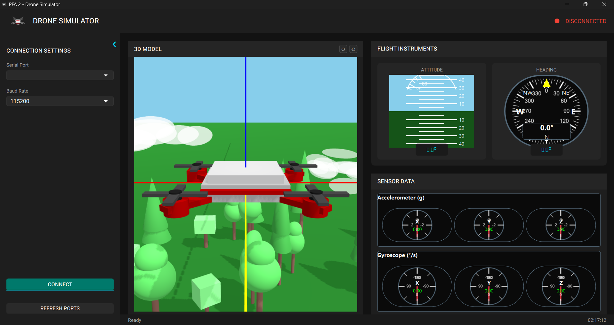

# STM32 3D Dashboard

A Qt 6 desktop dashboard for monitoring an STM32-based drone or flight controller.
The application reads orientation and motion data over a serial connection and
displays it through a 3D drone scene, attitude instruments, and live sensor gauges.



## Features

- Live quaternion-based 3D drone orientation
- Artificial horizon with pitch and roll indicators
- Compass and heading display
- Accelerometer gauges for X, Y, and Z axes
- Gyroscope gauges for X, Y, and Z axes
- Serial-port discovery and connection controls
- Configurable baud rate, including the default `230400`
- Interactive 3D scene with keyboard and mouse camera controls
- Qt resource packaging for QML, fonts, icons, and textures

## Requirements

- Qt 6 with the following modules:
  - Qt Quick
  - Qt Quick Controls 2
  - Qt Quick 3D
  - Qt Serial Port
  - Qt GUI and QML
- A C++17-compatible compiler
- An STM32 board or another device that provides the telemetry format described below

The project is configured for qmake in
[`STM32_3D_Dashboard.pro`](STM32_3D_Dashboard.pro).

## Build

### Qt Creator

1. Open `STM32_3D_Dashboard.pro` in Qt Creator.
2. Select a Qt 6 kit with the required modules.
3. Configure the project and build it.
4. Run the generated application.

### Command line

From the project directory, use a Qt 6 command prompt:

```powershell
qmake STM32_3D_Dashboard.pro
make
```

On Windows with the MinGW kit, use `mingw32-make` instead of `make`:

```powershell
qmake STM32_3D_Dashboard.pro
mingw32-make
```

For a distributable Windows build, run `windeployqt` against the generated
executable after building. The deployment tool must come from the same Qt kit
used to build the application.

## Serial telemetry protocol

The dashboard expects one newline-terminated CSV record per telemetry update with
exactly ten floating-point values:

```text
q0,q1,q2,q3,accelX,accelY,accelZ,gyroX,gyroY,gyroZ\n
```

The fields are interpreted as:

| Field | Description |
| --- | --- |
| `q0` ... `q3` | Orientation quaternion |
| `accelX` ... `accelZ` | Accelerometer values in g |
| `gyroX` ... `gyroZ` | Gyroscope values in degrees per second |

The serial connection uses 8 data bits, no parity, one stop bit, and no flow
control. Select the matching device port and baud rate in the dashboard sidebar.

## Controls

- Use the sidebar to select a serial port and baud rate, then connect.
- Use `W`/`S` to move the 3D camera forward/backward.
- Use `A`/`D` to move the camera left/right.
- Use `Q`/`E` to move the camera up/down.
- Hold the right mouse button and move the mouse to rotate the camera.
- Use the sidebar toggle to collapse or expand the connection panel.

## Project layout

```text
.
├── main.cpp                    # Application entry point and QML setup
├── SerialReader.*              # Qt serial-port reader and CSV parser
├── STM32_3D_Dashboard.pro     # qmake project definition
├── qml/
│   ├── DashboardWindow.qml     # Main dashboard window
│   ├── components/             # Dashboard widgets and 3D scene
│   └── assets/                 # Fonts, icons, and textures
├── icons/                      # Application icons
└── qml.qrc                     # Qt resource manifest
```

## Repository notes

Qt Creator's user-specific project settings are intentionally excluded from
version control. Build output and generated Qt files are also ignored.

## License

No license has been selected for this project yet. Add a license before
redistributing the code.
